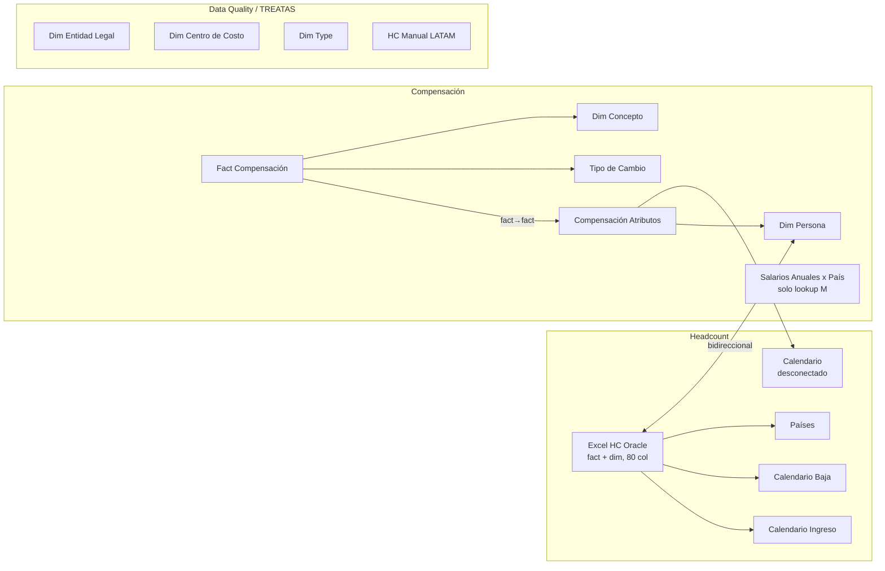
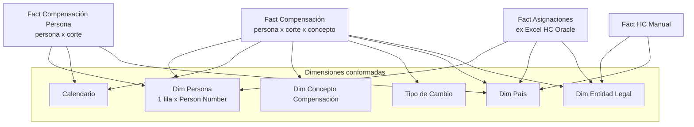

# Propuesta: modelo en estrella para HeadCount + Compensación

Modelo analizado: `HeadCount Oracle Actualizado.SemanticModel` (19 tablas, 9 relaciones). Fecha: 2026-10-14.

## 1. Diagnóstico

### Hechos relevados

| # | Problema | Evidencia |
|---|----------|-----------|
| 1 | `Excel HC Oracle` es fact y dimensión a la vez | 80 columnas, 100 medidas, 403 referencias en el reporte (el 85 % del total). Grano real = asignación: 2.549 filas / 1.948 personas; 595 personas con más de una fila, 487 con una asignación cerrada y otra activa. |
| 2 | Compensación cuelga de una cadena de 3 saltos con una relación bidireccional | `Fact Compensación` → `Compensación Atributos` (fact → fact por `Id Fila`) → `Dim Persona` ↔ `Excel HC Oracle` (bidireccional, N:1). `Calendario` llega a la fact de compensación solo a través de `Compensación Atributos`. |
| 3 | Atributos de persona en dos lugares | `Dim Persona` copia País Overview, Ámbito, Depto, Puesto, Grade y Tipo de Costo desde Oracle. La página Compensación Fija filtra por `Dim Persona`, el resto del reporte por `Excel HC Oracle`; el slicer "Grade Grupo" de Compensación Fija llega por la bidireccional. |
| 4 | Tres calendarios | `Calendario Ingreso` y `Calendario Baja` no aparecen en ningún visual (el reporte usa las columnas Año/Mes Ingreso de Oracle). `Calendario` queda desconectado por diseño para las medidas point-in-time. |
| 5 | Dos tablas por país | `Países` está relacionada con Oracle pero el reporte filtra por `Oracle[Country]` (texto); solo sirve de lookup en M. `Salarios Anuales por País` es otra tabla con la misma clave. País Overview se calcula dos veces (Oracle y Manual) con criterios distintos. |
| 6 | Tres dimensiones calculadas desconectadas con TREATAS | `Dim Entidad Legal`, `Dim Centro de Costo`, `Dim Type` existen solo para comparar Oracle contra `HC Manual LATAM` (snapshot desconectado, "Jun-2026" hardcodeado en la medida). |
| 7 | Lastre | 42 columnas de Oracle sin uso en visuales (8 niveles de managers, emails, Country_1, Legislation…), 15 medidas sin uso ni referencias, expresión `SharePoint` sin referencias, `HC Actuals 2025` hardcodeado. |
| 8 | Cruce de salarios frágil | Archivo actual (corte 2026-09-30, 1.295 filas): la columna Oracle ID viene vacía en el 100 % de las filas, así que todo el cruce depende del fallback por ID Nacional. |

### Modelo actual

## 2. Principios del modelo objetivo

1. Cada dato vive en un solo lugar: las facts llevan claves, fechas e importes; lo descriptivo va a dimensiones.
2. Relaciones 1:N, filtro en una sola dirección. Sin fact → fact, sin bidireccionales, sin TREATAS.
3. Un solo `Calendario`.
4. `Dim Persona` conformada: la misma tabla filtra headcount y compensación.
5. Regla de grano: **stocks** (HC activo, compensación) se cortan por `Dim Persona`; **flujos** (altas, bajas, rotación) por los atributos de la fila de asignación.

## 3. Modelo propuesto

### Dimensiones

| Tabla | Grano | Contenido | Origen |
|-------|-------|-----------|--------|
| `Calendario` | día | Único calendario, 2025-01 → hoy. Activo hacia `Fact Compensación[Fecha Corte]` y `Fact Compensación Persona[Fecha Corte]`. Sin relación con `Fact Asignaciones`: las medidas PIT lo siguen leyendo por MIN/MAX como hoy. | Calculada (igual que hoy) |
| `Dim Persona` | Person Number (+ fila −1 "Sin cruce") | Todo lo descriptivo según la asignación vigente: Nombre, Género, Fecha Nac., Edad, Rango Etario, ID Nacional, Fecha Ingreso, Antigüedad, Rango Antigüedad, Año/Mes Ingreso, Ámbito, Esquema MBO, Bonus Swap, Manager, Departamento, Puesto, Grade (Name/Nº/Grupo), Nivel, Función, Grupo Funcional, Entidad, País Overview, Tipo de Costo, Labor Type, Cross Charge. | M: `Oracle Persona Unica` (ya existe) |
| `Dim País` | Country Code | Country, País Overview, Orden, Moneda, Código Manual, Sueldos Anuales por ley. Única fuente de País Overview. | Fusión de `Países` + `Salarios Anuales por País` |
| `Dim Entidad Legal` | Código (3 dígitos) | Nombre Oracle, Nombre Manual, Country Code. Deja de ser calculada con UNION/TREATAS. | M |
| `Dim Concepto Compensación` | Concepto | Grupo (Fijo / Variable / …), Orden. Se extiende cuando llegue compensación variable. | Igual |
| `Tipo de Cambio` | Entidad Legal (columna "Entidad Legal", M, del archivo) o País del archivo, desde la hoja `TC` del archivo de salarios | TC fijo + sueldos anuales por clave. | Reemplaza FX BGT (2026-10-14) |
| Fase 2: `Dim Centro de Costo`, `Dim Tipo de Costo` | código | Reales, relacionadas a `Fact Asignaciones` y `Fact HC Manual`. Reemplazan los TREATAS de Data Quality. | M |

### Facts

| Tabla | Grano | Claves (FK) | Columnas propias | Notas |
|-------|-------|-------------|------------------|-------|
| `Fact Compensación` (centro) | persona × corte × concepto | Person Number, Fecha Corte, Concepto, Clave TC, Country Code, Código Entidad | Importe LC, Moneda, Cantidad de Salarios (multiplicador por fila, no sumar), Id Fila (oculta) | Sin relación con ninguna otra fact. Las claves de entidad/país se resuelven en M desde la asignación vigente, como hoy. |
| `Fact Compensación Persona` (hoy `Compensación Atributos`) | persona × corte | Person Number, Fecha Corte, Country Code | FTE, Cantidad de Salarios, Origen Cantidad, ACT/OFF, Seguro Salud/Vida, Línea Compañía, Método Cruce, Oracle ID, ID Nacional, flags de calidad | Se filtra por las mismas dims que la fact de importes; desaparece el vínculo por `Id Fila`. |
| `Fact Asignaciones` (hoy `Excel HC Oracle`) | asignación Oracle | Person Number, Código Entidad, Country Code, Local Cost Center | Fecha Ingreso, Fecha Baja, ACTIVE, Assignment Status, Action Name/Reason, y los atributos de la asignación necesarios para abrir bajas (Grade, Nivel, Función, Depto, Cross Charge, ZBB/COGS, Labor Type, Position) | Conserva atributos propios porque 487 personas tienen asignación cerrada + activa: una baja de 2025 se abre por el depto/grade al momento de la baja, no por el vigente. Se quitan ~30 columnas sin uso. |
| `Fact HC Manual` (hoy `HC Manual LATAM`) | persona del Excel manual | Código Entidad, Country Code (vía Código Manual), ID Centro de Costo | Igual que hoy | Se elimina el hardcode "Jun-2026" usando Fecha Snapshot. |

### Auxiliares de interfaz (desconectadas por diseño)

`Movimiento HC`, `Desglose Turnover`, `People Excellence KPI`, `People Excellence Columna`. Se mantienen tal cual, agrupadas en una carpeta "Aux".

### Alternativa evaluada y descartada

Meter FTE, Cantidad de Salarios y los beneficios Sí/No como conceptos de la fact larga (importe 1/0, Grupo "Beneficio"). Deja una sola fact pero mezcla indicadores con importes y rompe la semántica de `Importe LC`. Se puede revisar cuando entre la compensación variable.

## 4. Plan por fases

### Fase 1 · Compensación al centro (bajo riesgo, no toca páginas de headcount)

1. Relacionar `Fact Compensación` directo a `Dim Persona` y a `Calendario`; eliminar la relación `Fact Compensación → Compensación Atributos`. Renombrar `Compensación Atributos` → `Fact Compensación Persona`.
2. Cambiar `Excel HC Oracle ↔ Dim Persona` a una sola dirección (Oracle → Dim Persona, N:1). Agregar a `Dim Persona` los atributos que faltan (Grade Grupo, Nivel, Género, Entidad, Función, Manager, Rango Antigüedad, MBO, Bonus Swap).
3. Crear `Dim País` (fusión de `Países` + `Salarios Anuales por País` + País Overview/Orden). Relacionar `Fact Compensación[Country Code]` y `Fact Compensación Persona[Country Code]`.
4. Reescribir las medidas que leen `'Compensación Atributos'[Moneda]` y `[Fecha Corte]` para usar `Fact Compensación[Moneda]` y `Calendario`. `Variación Fijo vs Mes Anterior` se simplifica con el calendario conectado.
5. Reporte, página Compensación Fija: slicer "Grade Grupo" → `Dim Persona`; slicer "Fecha Corte" → `Calendario[Año-Mes]`; "País Origen" → `Dim País`.
6. Limpieza: borrar `Calendario Ingreso`, `Calendario Baja`, expresión `SharePoint`, 15 medidas muertas y las columnas de Oracle sin uso en visuales ni en M/DAX (managers 02-08, emails, Country_1, Legislation Code, Business Unit, Manager Type, Manager Job Name, Position Code, Mes Ingreso Nº, Año-Mes Ingreso, Trimestre Ingreso). Las que usa M/DAX internamente (Orden País, Person Gender, Date of Birth, ZBB/COGS, Country Code, Local Cost Center, Código Entidad, MBO Bonus Scheme, Bonus Swap Eligible, Level) quedan ocultas.

Resultado: 16 tablas, 10 relaciones, todas 1:N unidireccionales, un calendario, persona compartida.

### Fase 2 · Headcount en estrella

1. `Excel HC Oracle` → `Fact Asignaciones` (solo claves, fechas, estado y atributos de la asignación). `Dim Persona` completa pasa a ser el eje de todos los slicers de stock.
2. `Dim Entidad Legal`, `Dim Centro de Costo`, `Dim Tipo de Costo` reales, relacionadas a `Fact Asignaciones` y `Fact HC Manual`. Las medidas `HC Oracle x …` / `HC Manual x …` quedan sin TREATAS.
3. Rebinding del reporte: los ~110 campos de Oracle se reasignan en bloque con pbir CLI (la mayoría a `Dim Persona`; el parámetro `Desglose Turnover` y las páginas de validación siguen apuntando a `Fact Asignaciones`).

Riesgo a validar: en bajas por Depto/Función/Grade, las personas con reingreso cambian de corte si el slicer está en `Dim Persona` (99 / 62 / 24 personas con valores distintos entre filas). Las páginas de rotación conservan los atributos de la fila, así que el impacto queda acotado a cruces mixtos.

### Fase 3 · Movimientos (altas y bajas) bien contados

Alcance: solo este proyecto. `HeadCount LATAM Historial` es un proyecto aparte y se trata después.

1. `Fact Movimientos` derivada del export: una fila por alta o baja real de persona (sin contar reasignaciones de la misma persona como baja + alta) con su fecha relacionada a `Calendario`.
2. Altas y Bajas pasan a ser conteos simples sobre esa fact; se reducen las copias de la lógica "activo a la fecha D".

## 5. Detalles que se conservan

- Person Number −1 y fila "Sin cruce con Oracle" en `Dim Persona`.
- Método Cruce (Oracle ID / ID Nacional / Sin cruce), discrepancias y duplicados como columnas de `Fact Compensación Persona`.
- Fallback de Cantidad de Salarios por ley del país (ahora en `Dim País`).
- Tipo de cambio fijo y sueldos anuales de la hoja `TC` del archivo de salarios, clave Entidad Legal con fallback a País (`Clave TC`).
- Parche Cross Charge Global y columna `Cross Charge Origen`.
- Todas las medidas de validación (`Val · …`), People Excellence y waterfall.

## 6. Estado (2026-10-14) · implementado en HeadCount Oracle Actualizado (sin commitear)

### Modelo resultante

| Tabla | Rol | Relaciones |
|---|---|---|
| `Dim Persona` | Persona conformada: atributos fijos + valor vigente de los de asignación; columnas sin uso ocultas en carpeta "Oracle · otros" | → `Dim Entidad Legal` |
| `Asignaciones` (ex `Excel HC Oracle`) | Una fila por asignación del export; base de las medidas de HC point-in-time | → `Dim Persona`, `Dim Centro de Costo`, `Dim Type` |
| `Fact Movimientos` | Altas y egresos reales (sin reasignaciones) | → `Asignaciones`, `Calendario` |
| `Fact Compensación` | Importes por persona, corte y concepto | → `Dim Persona`, `Calendario`, `Dim País`, `Dim Concepto Compensación`, `Tipo de Cambio` |
| `Fact Compensación Persona` | FTE, beneficios y calidad del cruce por persona y corte | → `Dim Persona`, `Calendario`, `Dim País` |
| `HC Manual LATAM` | Último snapshot del archivo manual | → `Dim Entidad Legal`, `Dim Centro de Costo`, `Dim Type` |
| `Calendario`, `Dim País`, `Dim Entidad Legal`, `Dim Centro de Costo`, `Dim Type`, `Dim Concepto Compensación`, `Tipo de Cambio` | Dimensiones (M, sin tablas calculadas ni TREATAS) | |
| `Movimiento HC`, `Desglose Turnover`, `People Excellence KPI/Columna` | Auxiliares de interfaz, desconectadas por diseño | |

Todas las relaciones son 1:N con filtro en una sola dirección. `Calendario` no se relaciona con `Asignaciones` a propósito (medidas point-in-time).

### Decisiones tomadas con el usuario

- Altas/bajas = egresos reales: una asignación cerrada y reemplazada por otra no cuenta.
- Páginas de rotación y validación (Rotación, Validación Turnover, Validación Data, Data Quality) y la tabla de Detalle Dotación usan atributos de la asignación; el resto de las páginas usa los vigentes de `Dim Persona`.
- HC Manual toma el último snapshot del archivo (hoy sigue siendo junio 2026).
- Columnas sin uso del export: ocultas en `Dim Persona`, no borradas.

### Validación (refresh completo, contra el modelo original)

- Sin cambios: HC activo (total y por país, función, grade, entidad), HC cierre 2025, compensación (total, por país y tipo de costo), edad, % femenino, MBO, antigüedad, nº entidades, HC Manual y la tabla de entidades de Data Quality.
- Cambian a propósito: altas/bajas/rotación (2025: altas 775 → 411, bajas 726 → 364; rotación 12M 46,7 % → 24,5 %). La conciliación HC inicio + altas − bajas = HC fin da 0 en todos los meses (antes no cerraba) y las bajas mensuales coinciden con el historial SCD2 del proyecto Historial.
- Cambian por corrección: "Sin Grade" (36 activos / 57 bajas salían como G1-G7) y la Dotación por función ya no cuenta dos veces a quien cambió de función.

### Hallazgos de datos pendientes

- `ACT/OFF` del archivo de salarios trae la entidad legal, no el estado (columna "BU Adjusted", mal mapeada). No la usa ningún visual. Desde 2026-10-15 las columnas del archivo de salarios se toman por encabezado (fila 3), no por posición.
